<a href="https://frjr17.com">
<picture>
  <source media="(prefers-color-scheme: dark)" srcset="dist/header-noir.svg">
  <source media="(prefers-color-scheme: light)" srcset="dist/header-paper.svg">
  
</picture>
</a>

<picture>
  <source media="(prefers-color-scheme: dark)" srcset="dist/stats-noir.svg">
  <source media="(prefers-color-scheme: light)" srcset="dist/stats-paper.svg">
  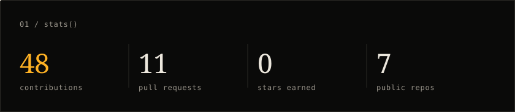
</picture>

<picture>
  <source media="(prefers-color-scheme: dark)" srcset="dist/languages-noir.svg">
  <source media="(prefers-color-scheme: light)" srcset="dist/languages-paper.svg">
  
</picture>

<picture>
  <source media="(prefers-color-scheme: dark)" srcset="dist/activity-noir.svg">
  <source media="(prefers-color-scheme: light)" srcset="dist/activity-paper.svg">
  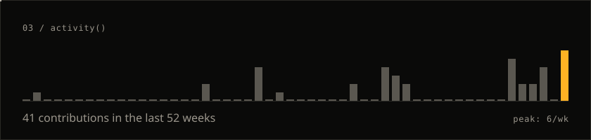
</picture>

<picture>
  <source media="(prefers-color-scheme: dark)" srcset="dist/now-noir.svg">
  <source media="(prefers-color-scheme: light)" srcset="dist/now-paper.svg">
  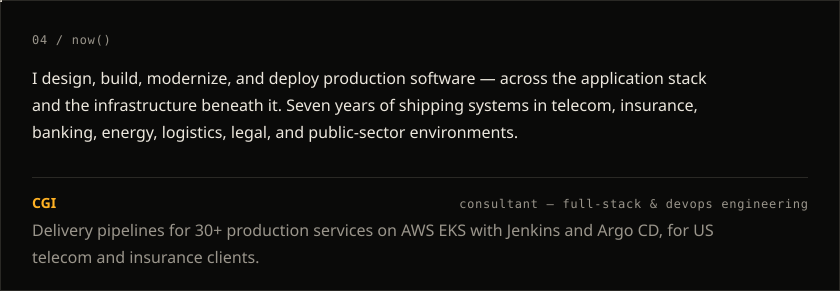
</picture>

<a href="https://frjr17.com/en/work/enterprise-cicd-modernization">
<picture>
  <source media="(prefers-color-scheme: dark)" srcset="dist/work-01-noir.svg">
  <source media="(prefers-color-scheme: light)" srcset="dist/work-01-paper.svg">
  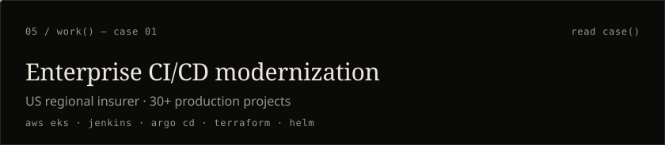
</picture>
</a>

<a href="https://frjr17.com/en/work/container-hardening">
<picture>
  <source media="(prefers-color-scheme: dark)" srcset="dist/work-02-noir.svg">
  <source media="(prefers-color-scheme: light)" srcset="dist/work-02-paper.svg">
  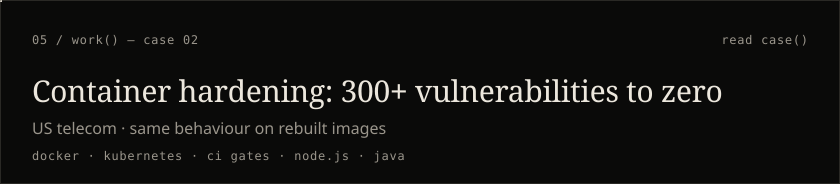
</picture>
</a>

<a href="https://frjr17.com/en/work/legacy-financial-web-platform">
<picture>
  <source media="(prefers-color-scheme: dark)" srcset="dist/work-03-noir.svg">
  <source media="(prefers-color-scheme: light)" srcset="dist/work-03-paper.svg">
  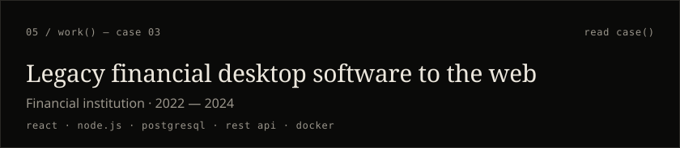
</picture>
</a>

<a href="https://frjr17.com/en/work/invoice-processing-automation">
<picture>
  <source media="(prefers-color-scheme: dark)" srcset="dist/work-04-noir.svg">
  <source media="(prefers-color-scheme: light)" srcset="dist/work-04-paper.svg">
  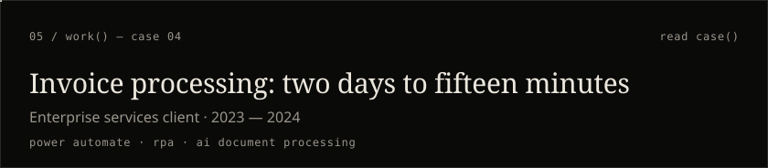
</picture>
</a>

<picture>
  <source media="(prefers-color-scheme: dark)" srcset="dist/experience-noir.svg">
  <source media="(prefers-color-scheme: light)" srcset="dist/experience-paper.svg">
  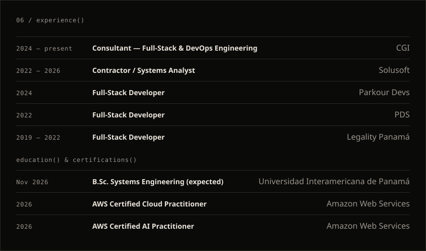
</picture>

<a href="https://www.credly.com/badges/a14c05dc-b37e-45d3-845b-07fbcaedf7fd/public_url"><picture><source media="(prefers-color-scheme: dark)" srcset="dist/badge-aws-cloud-practitioner-noir.svg"><source media="(prefers-color-scheme: light)" srcset="dist/badge-aws-cloud-practitioner-paper.svg">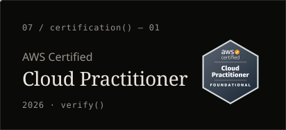</picture></a>
<a href="https://www.credly.com/badges/5f886c31-e20b-43e0-89ee-f5395968eb98/public_url"><picture><source media="(prefers-color-scheme: dark)" srcset="dist/badge-aws-ai-practitioner-noir.svg"><source media="(prefers-color-scheme: light)" srcset="dist/badge-aws-ai-practitioner-paper.svg">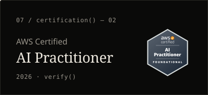</picture></a>

<a href="https://frjr17.com/en/contact">
<picture>
  <source media="(prefers-color-scheme: dark)" srcset="dist/contact-noir.svg">
  <source media="(prefers-color-scheme: light)" srcset="dist/contact-paper.svg">
  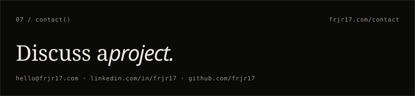
</picture>
</a>

<a href="https://frjr17.com"><picture><source media="(prefers-color-scheme: dark)" srcset="dist/social-website-noir.svg"><source media="(prefers-color-scheme: light)" srcset="dist/social-website-paper.svg"></picture></a>
<a href="https://github.com/frjr17"><picture><source media="(prefers-color-scheme: dark)" srcset="dist/social-github-noir.svg"><source media="(prefers-color-scheme: light)" srcset="dist/social-github-paper.svg">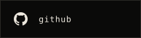</picture></a>
<a href="https://linkedin.com/in/frjr17"><picture><source media="(prefers-color-scheme: dark)" srcset="dist/social-linkedin-noir.svg"><source media="(prefers-color-scheme: light)" srcset="dist/social-linkedin-paper.svg"></picture></a>
<a href="mailto:hello@frjr17.com"><picture><source media="(prefers-color-scheme: dark)" srcset="dist/social-email-noir.svg"><source media="(prefers-color-scheme: light)" srcset="dist/social-email-paper.svg"></picture></a>

